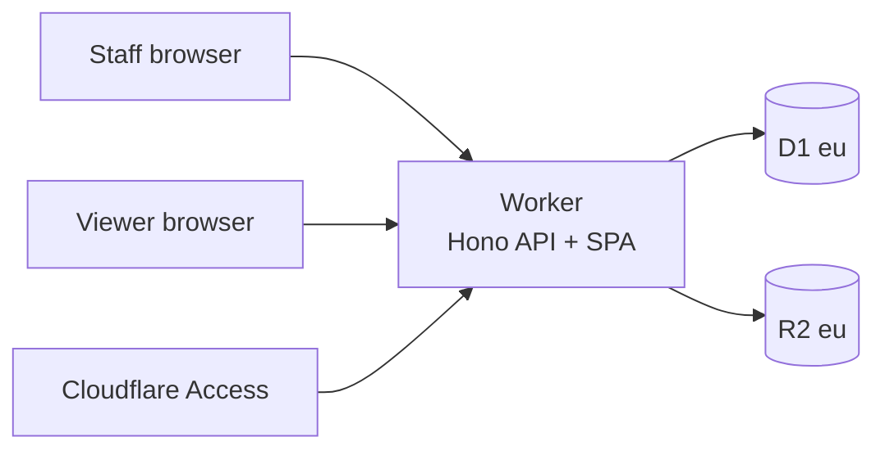

# Architecture

ManDoc is a ports-and-adapters monorepo. Domain logic sits in `packages/core` and imports nothing from a platform. Adapters touch Cloudflare. Move platform, swap adapters.

Where this page and the code disagree, the code wins.

## Overview

One Worker serves `/api/*` and the React app from static assets. The Worker runs first, so asset responses get the same security headers as API responses.

| Piece | Where |
|---|---|
| Worker, routes, grant check, PDF stamp | `apps/api` |
| Staff library and viewer | `apps/web` |
| Tokens, grants, roles, CSRF, retention rules | `packages/core` |
| Drizzle schema and repositories | `packages/db` |
| R2, Access JWT, in-memory storage for tests | `packages/cf` |
| Browser journey | `e2e` |

## Vision, mapped

Vision was read, not copied. The patterns below are the ones ManDoc keeps.

| Vision | ManDoc |
|---|---|
| `packages/core` ports, no platform imports | Same split |
| D1 in the EU, repositories behind Drizzle | Same, document tables instead of videos |
| R2 binding, multipart upload, no S3 keys | 8 MiB parts, 2 GiB cap |
| Share token: 128-bit random, SHA-256 lookup, AES-GCM sealed copy | Same |
| Unknown, revoked, and expired links answer the same | Same body, `{ "error": "not_found" }` |
| Viewer email code, then a session cookie scoped to the share | Same, one cookie |
| Signed playback grant, no storage URL | Signed view grant, re-checked on every byte request |
| `MAILER=disabled`, copy the link | Same. Local codes go to `dev_outbox` |
| Cloudflare Access in production, OTP in local dev | Same switch. Production refuses OTP |
| Audit log of staff actions | Same, metadata is filtered |
| Daily retention cron | `0 3 * * *` calls `runRetention`. The workflow class is the same job |
| `__Host-` session cookie, CSRF header, CSP, HSTS | Cookie names `__Host-mandoc_session` and `__Host-mandoc_viewer`. Header `X-Mandoc-Request` |
| Admin and member. No viewer role | Same. Bootstrap email is admin. Everyone else is a member |

Dropped, and what replaces them:

| Dropped | Replacement |
|---|---|
| HLS, hls.js, segment grants | PDF.js for PDF. Office view is text rendered in the browser, not the package |
| Watermark burned into a video frame | PDF view and download are stamped with pdf-lib. Office bytes are refused while a watermark is on |
| Media container, ffmpeg, Durable Object | Nothing. The worker stores the original bytes |
| Whisper, Workers AI, Vectorize, transcript search | Nothing. No model |
| Customer detection and publish review | A document is readable when the upload completes |
| Rooms, knowledge base, MCP connections | Not part of this product |

## Decisions

- PDF.js in the browser. The worker does not render pages.
- Office preview reads text out of the zip in the worker. The browser renders paragraphs, slides, or a sheet. The view response is JSON, not the package and not a storage URL. It is not a layout preview. Conversion to PDF is not in this slice.
- Copy-link only. `MAILER=disabled` in production. Local dev uses `dev-outbox`.
- View is the default. Download and watermark are off until the sender turns them on.
- Watermark on means a PDF view and download are stamped, up to 32 MiB. The server does not return the original bytes. Larger PDFs fail closed. Office files with a watermark fail closed on view and on download. An Office view without a watermark is a text preview up to 32 MiB, still not the package. The page also draws the email as an overlay on a PDF. Screen capture is not prevented.
- Share expiry must sit between 5 minutes and 366 days. That cap is a safety limit, not a retention period.
- Document retention days start null, so a new deploy does not age out live files. An admin sets the number at `PATCH /api/admin/retention`. The purge job then deletes live documents older than that many days, and it always deletes soft-deleted documents, expired sessions, and abandoned uploads.
- New staff are members. There is no domain allowlist until one is set. Production Access is the gate in front of the worker.
- A viewer who was not on the recipient list can still verify. That open is audited as `share.forward`.
- Password policy is 8 to 200 characters, PBKDF2-SHA-256, 100,000 iterations.
- Grants last 300 seconds, clamped between 30 and 3600 if the var is set.
- Staff sessions idle out after 8 hours and end after 7 days. Viewer sessions end at the share expiry or after 7 days, whichever is first.
- OTP codes last 10 minutes and allow 5 attempts. Requests are capped at 5 per email and 30 per address per 15 minutes, then the route still answers 202 and sends nothing.
- Part size is 8 MiB so every part except the last meets R2's 5 MiB minimum.

## Data model

`packages/db/migrations/0001_init.sql` and `packages/db/src/schema.ts`.

- `users`, `sessions`, `otp_challenges`, `rate_limits`
- `documents`, `document_versions`, `uploads`
- `shares` (`token_hash`, `sealed_token`, no raw token), `share_recipients`, `viewer_sessions`, `grants`, `events`
- `audit_log`, `retention_policies`, `dev_outbox`

## Request path

1. `POST /api/uploads`, then `PUT /api/uploads/:id/parts/:n`, then `POST /api/uploads/:id/complete`.
2. `POST /api/documents/:id/shares` returns `/s/<token>`.
3. `GET /api/public/s/:token` returns the title or the same not-found body as a dead link.
4. OTP verify sets `__Host-mandoc_viewer`.
5. `POST /api/public/s/:token/grant` returns a grant: `base64url(claims).base64url(hmac)`.
6. `GET /api/view/:grant` and `GET /api/download/:grant` check the signature, the grant row, the cookie, and the share. PDF view supports range requests. Office view returns a text preview. Download returns bytes only when the share allows it.

## Security headers

`default-src 'self'`, `script-src 'self'`, `frame-ancestors 'none'`, `object-src 'none'`, `base-uri 'none'`, `referrer-policy: no-referrer`, `X-Frame-Options: DENY`, `X-Content-Type-Options: nosniff`, COOP, a locked permissions policy, `Cache-Control: no-store`. HSTS is set on https responses only, so local http is usable. `style-src` allows inline styles because the watermark overlay and the dialog use them. Scripts do not.

Non-safe `/api/*` requests need `X-Mandoc-Request: 1` and an `Origin` equal to `APP_ORIGIN`.
